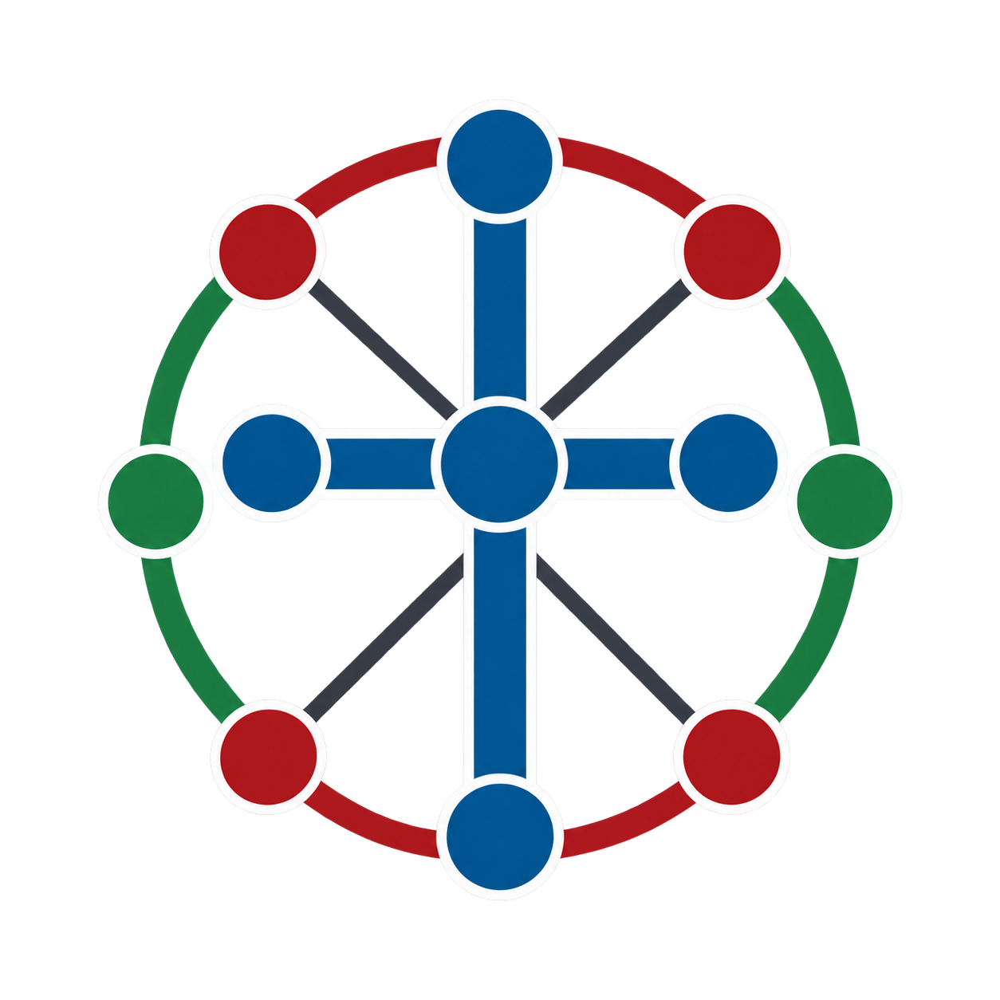

# Christian Denominations Reconciliation

**How does Wikidata classify 19 selected Christian church bodies—and what does that mean for discovering denominations?**



[Live Wikidata project](https://www.wikidata.org/wiki/Wikidata:WikiProject_Ontology/Ontology_Course/Projects_Offering_3/Christian_Denominations_Reconciliation) · [Exact source revision](https://www.wikidata.org/w/index.php?oldid=2562414623) · [PowerPoint demo](presentation/demo.pptx) · [PDF demo](presentation/demo.pdf) · [Speaker notes](presentation/speaker-notes.md)

This repository packages the complete project page, including its exploration tables, seven queries, 19 reviews, comparison table, references, and limitations. The page content below is a Markdown conversion of revision **2562414623**, saved on **30 October 2026 at 02:56:02 UTC**. Earlier result dates are retained; these are recorded snapshots, not claims about current live counts.

## Attribution

Prepared collaboratively with **Codex (OpenAI)**, which assisted with query development, data analysis, writing, repository organization, and presentation preparation. **Tyler T. Procko** provided the research direction, selected and refined the scope, reviewed findings, and guided revisions.

## Start here

1. Present the seven-slide demo (about five minutes).
2. Run query 05 to inspect the 19 selected records.
3. Run query 06 to compare the instance-based and subclass-only paths.
4. Run query 07 to explore the additional candidates outside the sample.

**Finding:** 16 of 19 selected records match the instance-based denomination path. Three do not. Subclass-only traversal recovers none of those three, but finds 58 additional candidates outside the sample. Those candidates mix general categories and named bodies; they are not a validated count of 58 more denominations.

**Interpretation:** There is no uniform direct classification pattern across the sample. Some differences are compatible or redundant; others raise questions about specificity, rank, naming, or organizational scale. This limited study does not prove that all variation is wrong or quantify Wikidata’s overall coverage.

## Repository contents

| Location | Contents |
|---|---|
| `README.md` | Full project content in GitHub Markdown |
| `queries/` | Standalone SPARQL `.rq` files, with explicit prefixes |
| `results/` | Recorded query outputs and provenance notes |
| `presentation/` | Editable PowerPoint, matching PDF, and a short speaking script |
| `source/` | Original wikitext and English labels used in conversion |
| `assets/` | Locally recovered project logo; no Commons dependency |

## Query index

| File | Purpose |
|---|---|
| [01-denomination-count.rq](queries/01-denomination-count.rq) | Count through the denomination hierarchy |
| [02-alternate-classifications.rq](queries/02-alternate-classifications.rq) | Compare alternate direct classifications |
| [03-christian-affiliation-count.rq](queries/03-christian-affiliation-count.rq) | Count Christian affiliations |
| [04-affiliation-types.rq](queries/04-affiliation-types.rq) | Explore types of affiliated items |
| [05-selected-19-classifications.rq](queries/05-selected-19-classifications.rq) | Inspect the selected 19 churches |
| [06-selected-19-path-comparison.rq](queries/06-selected-19-path-comparison.rq) | Compare both paths for the 19 |
| [07-subclass-only-candidates.rq](queries/07-subclass-only-candidates.rq) | Find additional subclass candidates |
| [08-efca-statement-ranks.rq](queries/08-efca-statement-ranks.rq) | Supporting check: expose EFCA’s statement ranks and test each type’s subclass path |

Open a `.rq` file and paste its contents into [Wikidata Query Service](https://query.wikidata.org/) or [QLever for Wikidata](https://qlever.dev/wikidata). The alternate-classification query uses `SERVICE wikibase:label`, which is specific to WDQS and may need replacing with an English `rdfs:label` lookup on other engines. Different endpoints can reflect different data snapshots. Counts from overlapping categories must not be added together.

The seven queries from the page are reproduced inline below. Query 08 is the supporting rank check discussed in the individual reviews. No authentication or local installation is needed to read this repository.

## Full project page


## Participants

- [TPROCKOPHD](https://www.wikidata.org/wiki/User:TPROCKOPHD) - Tyler T. Procko, Ph.D.
- Codex from OpenAI

## Description

This project explores how Wikidata represents a small selection of Christian church bodies. It is an investigation of knowledge organization, rather than an effort in ecumenics or a count of all denominations worldwide.

**Research question: How does Wikidata classify the selected 19 churches?**

For each selected church (a small set of 19 for brevity), I examine what it is classified as, how those classifications connect to broader classes, and whether a query for Christian denominations finds it. I compare the records to identify common patterns, meaningful differences, and possible modeling issues. Some differences may reflect church structure or scale rather than errors.

The related-entry tables and exploratory queries below provide background. The main investigation is the individual review of 19 selected records, summarized in one comparison table at the end.

## Related Entries Already Present on Wikidata

As an initial foray into this project, some time was spent with manual searching/exploration, and parallel sub-agent workflows of Codex models to find related entries already present within Wikidata.

These tables collect starting points for exploring how Wikidata represents Christianity and its denominations. The groupings organize the project, and the Type column gives working descriptions for investigation. Comments record relevance and questions for later queries.

Timestamps describe Wikidata record revisions, recorded on 29 October 2026; Z denotes UTC. N/A marks resources or placeholder rows without a Wikidata entity record.

### General

| Wikidata Item | Type | Wikidata record created (UTC) | Wikidata record last changed (UTC) | Comment |
|----|----|----|----|----|
| [second-order class (Q24017414)](https://www.wikidata.org/wiki/Q24017414) | Item (metaclass) | 2016-05-05T11:29:52Z | 2026-10-20T14:24:40Z | Directly relevant to your question about Christian denominational family and how it relates to denominations. |
| [instance of (P31)](https://www.wikidata.org/wiki/P31) | Property | 2013-02-04T20:46:46Z | 2026-10-29T05:34:52Z | Identifies the class or classes under which an item is recorded. Compare how named churches, denominations, movements, and their broader families are typed. |
| [subclass of (P279)](https://www.wikidata.org/wiki/P279) | Property | 2013-03-12T22:59:46Z | 2026-10-28T20:42:24Z | Builds class hierarchies and affects which items broader queries retrieve. Examine whether each link means that every instance of the narrower class also belongs to the broader class. |
| [is metaclass for (P8225)](https://www.wikidata.org/wiki/P8225) | Property | 2020-05-19T22:12:52Z | 2026-10-09T16:34:41Z | Directly relevant to your question about Christian denominational family and how it relates to denominations. |
| [different from (P1889)](https://www.wikidata.org/wiki/P1889) | Property | 2015-05-19T16:21:55Z | 2026-10-28T22:22:19Z | Useful for investigating similarly named churches, overlapping concepts, and disputed equivalences. P460 alone wouldn’t justify merging items. |
| [said to be the same as (P460)](https://www.wikidata.org/wiki/P460) | Property | 2013-04-25T08:01:03Z | 2026-10-04T20:25:11Z | Useful for investigating similarly named churches, overlapping concepts, and disputed equivalences. P460 alone wouldn’t justify merging items. |
| [part of (P361)](https://www.wikidata.org/wiki/P361) | Property | 2013-03-27T15:49:40Z | 2026-10-23T06:44:31Z | Relates a component to a larger whole. Examine what the whole represents when this connects churches, communions, or Christian traditions. |
| [has part(s) (P527)](https://www.wikidata.org/wiki/P527) | Property | 2013-05-17T12:31:55Z | 2026-10-29T15:38:28Z | Records parts from the perspective of the whole. Compare component lists with links in the opposite direction, and examine whether the items refer to organizations or classes. |
| [has part(s) of the class (P2670)](https://www.wikidata.org/wiki/P2670) | Property | 2016-03-27T11:34:09Z | 2026-10-16T17:08:42Z | Describes the class of parts of a particular whole. Review uses on denominational families against [Help:Basic membership properties](https://www.wikidata.org/wiki/Help:Basic_membership_properties), especially where the subject also functions as a class. |
| [parent organization or unit (P749)](https://www.wikidata.org/wiki/P749) | Property | 2013-08-02T13:09:33Z | 2026-09-28T20:01:41Z | Connects an organization or organizational unit to its parent. Explore how this represents church administration and how it differs from membership in religious associations. |
| [member of (P463)](https://www.wikidata.org/wiki/P463) | Property | 2013-04-25T15:51:22Z | 2026-10-16T18:34:26Z | Records membership in an organization. Useful for exploring councils and associations; examine dates and whether membership is being confused with organizational control. |
| [basic form of government (P122)](https://www.wikidata.org/wiki/P122) | Property | 2013-02-18T19:29:14Z | 2026-10-13T20:30:55Z | Compare church governance alongside denomination membership. P122’s constraints explicitly include religious denominations and ecclesiastical polity. |
| [founder (P112)](https://www.wikidata.org/wiki/P112) | Property | 2013-02-17T00:31:36Z | 2026-10-05T09:47:31Z | Connect people and organizations to foundations, schisms, and councils. |
| [participant (P710)](https://www.wikidata.org/wiki/P710) | Property | 2013-07-24T23:42:41Z | 2026-10-17T13:31:44Z | Connect people and organizations to foundations, schisms, and councils. |
| [inception (P571)](https://www.wikidata.org/wiki/P571) | Property | 2013-05-29T19:46:29Z | 2026-10-24T15:33:42Z | Records when the subject began. For churches, investigate whether the date refers to historical origins, formal organization, incorporation, or a later reconstitution. |
| [dissolved, abolished or demolished (P576)](https://www.wikidata.org/wiki/P576) | Property | 2013-05-29T21:15:34Z | 2026-09-29T16:30:09Z | Records when the subject ceased to exist. Examine whether a church body was dissolved or absorbed into another organization, and whether its institutional successors are identified. |
| [start time (P580)](https://www.wikidata.org/wiki/P580) | Property | 2013-05-30T12:09:34Z | 2026-10-11T21:25:22Z | Can qualify when an affiliation, role, or relationship began. Useful for reconstructing how church membership and organizational relationships change over time. |
| [end time (P582)](https://www.wikidata.org/wiki/P582) | Property | 2013-05-30T12:11:39Z | 2026-10-11T21:24:57Z | Can qualify when an affiliation, role, or relationship ended. Examine whether historical associations are dated clearly enough to distinguish past and current relationships. |
| [replaces (P1365)](https://www.wikidata.org/wiki/P1365) | Property | 2014-06-22T08:41:10Z | 2026-10-23T11:36:43Z | Links a subject to something it superseded. Examine institutional succession after reorganizations or unions, including whether the source supports a change of identity. |
| [replaced by (P1366)](https://www.wikidata.org/wiki/P1366) | Property | 2014-06-22T08:41:19Z | 2026-09-14T11:17:29Z | Links a subject to its replacement. Useful for following historical church bodies forward and comparing successor relationships with dissolution dates. |
| [follows (P155)](https://www.wikidata.org/wiki/P155) | Property | 2013-02-25T22:08:04Z | 2026-10-22T20:47:32Z | Records the immediately preceding item in a sequence. Inspect what sequence is intended when used for churches; sequence alone does not establish organizational descent. |
| [followed by (P156)](https://www.wikidata.org/wiki/P156) | Property | 2013-02-25T22:08:34Z | 2026-10-29T14:02:13Z | Records the immediately following item in a sequence. Compare its use with replacement and merger properties when tracing church histories. |
| [separated from (P807)](https://www.wikidata.org/wiki/P807) | Property | 2013-08-17T01:32:50Z | 2026-10-12T21:41:02Z | Directly relevant to the formation of a church through separation from another body. Examine dates, the separating organizations, and whether a distinct schism event is also represented. |
| [merged into (P7888)](https://www.wikidata.org/wiki/P7888) | Property | 2020-01-29T16:48:13Z | 2026-09-19T11:46:50Z | Records a subject being dissolved and merged into an organization that already existed. Examine whether a church union instead created a new body, and whether its relationships reflect that distinction. |
| [influenced by (P737)](https://www.wikidata.org/wiki/P737) | Property | 2013-08-01T10:21:47Z | 2026-09-03T14:14:26Z | Captures influence from people, movements, or ideas. Useful for exploring theological connections across denominational boundaries; inspect sources before treating influence as a precise doctrinal commitment. |
| [has cause (P828)](https://www.wikidata.org/wiki/P828) | Property | 2013-08-27T18:18:12Z | 2026-10-15T12:35:08Z | Connects an effect with its underlying cause. Investigate how sources support explanations of schisms, including theological, political, and institutional factors. |
| [WikiProject Ontology metaclasses guide](https://www.wikidata.org/wiki/Wikidata:WikiProject_Ontology/Metaclasses) | Guidance page | N/A | N/A | Explains class-of-classes modeling relevant to Christian denominational family. |

General ontology terms, properties, and related resources

### Religion

| Wikidata Item | Type | Wikidata record created (UTC) | Wikidata record last changed (UTC) | Comment |
|----|----|----|----|----|
| [religion (Q9174)](https://www.wikidata.org/wiki/Q9174) | Item (class/concept) | 2012-11-02T20:34:23Z | 2026-10-17T13:32:26Z | Broad starting point for locating Christianity in the religion hierarchy. Compare how individual religions and classes of religions are connected, and how those choices affect the items returned by queries. |
| [Abrahamic religion (Q47280)](https://www.wikidata.org/wiki/Q47280) | Item (class/concept) | 2012-11-13T19:25:57Z | 2026-09-01T09:27:41Z | Places Christianity in a broader religious grouping. Explore how membership in this grouping is expressed and whether instance and subclass relationships are used consistently. |
| [religious denomination (Q13414953)](https://www.wikidata.org/wiki/Q13414953) | Item (class) | 2013-06-02T15:11:13Z | 2026-08-21T16:37:32Z | Provides a comparison point for denominations across religions. Investigate how the boundary between a religious denomination, a religious tradition, and an organization is represented. |
| [religious organization (Q1530022)](https://www.wikidata.org/wiki/Q1530022) | Item (class) | 2012-12-23T10:05:35Z | 2026-10-27T01:19:23Z | Useful for examining institutions such as churches and religious associations. Compare organizational identity and governance with the beliefs or traditions associated with those bodies. |
| [religious movement (Q1826286)](https://www.wikidata.org/wiki/Q1826286) | Item (class) | 2012-12-28T03:34:11Z | 2026-10-10T05:47:54Z | Provides a broader context for Christian movements. Examine whether movements span multiple denominations, develop into organizations, or remain loosely organized, and how those differences are recorded. |
| [sect (Q19097)](https://www.wikidata.org/wiki/Q19097) | Item (class) | 2012-11-10T05:26:35Z | 2026-09-25T04:50:17Z | Investigate how historical context and source terminology affect the use of sect, especially when an item is also described as a denomination or religious movement. |
| [religious order (Q2061186)](https://www.wikidata.org/wiki/Q2061186) | Item (class) | 2012-12-30T17:42:47Z | 2026-09-23T08:59:50Z | A useful boundary case: investigate whether orders, congregations, and denominations are consistently distinguished. |
| [schism (Q41521)](https://www.wikidata.org/wiki/Q41521) | Item (class/concept) | 2012-11-13T07:40:20Z | 2026-08-12T08:16:34Z | Useful for investigating religious divisions. Compare the division itself, any dated events associated with it, and the organizations that continued or emerged afterward. |
| [religion or worldview (P140)](https://www.wikidata.org/wiki/P140) | Property | 2013-02-23T23:14:40Z | 2026-10-11T15:39:00Z | Connects an item to a religion or worldview. Compare the specificity of its values, from Christianity to particular traditions, and how this affects searches for affiliated people and organizations. |
| [WikiProject Religions](https://www.wikidata.org/wiki/Wikidata:WikiProject_Religions) | WikiProject page | N/A | N/A | Closest domain project: it works on a religion taxonomy and models historical links such as forks, unions, and influence. Its ontology recommendations are still under discussion, making them useful comparison points rather than settled rules. |
| [WikiProject Religions ontology guide](https://www.wikidata.org/wiki/Wikidata:WikiProject_Religions/Ontology) | Guidance page | N/A | N/A | Modeling recommendations for religious movements, classifications, dates, and relationships. |
| [List of religious groups](https://www.wikidata.org/wiki/Wikidata:WikiProject_Religions/List_of_religious_groups) | Query-generated list | N/A | N/A | Bot-maintained list based on the religion hierarchy; useful as a comparison set, not a complete denomination inventory. |
| [Religion & Theology Community of Practice](https://www.wikidata.org/wiki/Wikidata:WikiProject_Wikidata_Religion_%26_Theology_Community_of_Practice) | Community project page | N/A | N/A | Its draft event model includes schisms in Christianity and suggests event dates, location, participants, and cause. |

Religious concepts, affiliations, and related resources

### Christianity

| Wikidata Item | Type | Wikidata record created (UTC) | Wikidata record last changed (UTC) | Comment |
|----|----|----|----|----|
| [Christianity (Q5043)](https://www.wikidata.org/wiki/Q5043) | Item (concept) | 2012-11-01T02:04:06Z | 2026-10-27T11:15:30Z | Central starting point for the investigation. Explore how the item functions as a religion, a tradition, and a broader organizing concept, and what its instance and subclass links imply. |
| [Christian denomination (Q879146)](https://www.wikidata.org/wiki/Q879146) | Item (class) | 2012-12-14T00:39:11Z | 2026-10-10T06:29:36Z | A primary starting class for finding denominations. Compare direct instances with instances of subclasses, and review what each approach includes or misses. |
| [Christian denominational family (Q123129246)](https://www.wikidata.org/wiki/Q123129246) | Item (class) | 2023-10-19T19:47:10Z | 2026-07-31T12:13:59Z | Useful for examining how denominations are grouped into families. Investigate whether a family is treated as a class of denominations, a broader tradition, or another kind of entity, and how P31, P279, and P8225 interact. |
| [Christian movement (Q995347)](https://www.wikidata.org/wiki/Q995347) | Item (class) | 2012-12-15T19:59:35Z | 2026-10-10T06:04:30Z | Useful for exploring Christian developments that may cross institutional boundaries. Compare how movements relate to denominations, organizations, and theological influences. |
| [Christian organization (Q94670589)](https://www.wikidata.org/wiki/Q94670589) | Item (class) | 2020-05-18T01:56:56Z | 2026-10-26T18:31:26Z | Provides an institutional view of Christianity. Examine which kinds of organizations are included and how churches, missions, associations, and other bodies are distinguished. |
| [church congregation (Q2638480)](https://www.wikidata.org/wiki/Q2638480) | Item (class) | 2013-01-06T06:06:09Z | 2026-10-27T13:31:32Z | Useful for examining communities at a local scale. Check whether congregations are clearly distinguished from buildings, administrative units, and larger denominational organizations. |
| [Christian Church (Q34651)](https://www.wikidata.org/wiki/Q34651) | Item (ambiguous concept) | 2012-11-12T20:23:51Z | 2026-09-21T06:45:25Z | Raises a central question about what Church denotes. Examine whether the item concerns a theological concept, a community of believers, or an institution, and how related items distinguish these senses. |
| [ecclesiastical polity (Q2526886)](https://www.wikidata.org/wiki/Q2526886) | Item (class/concept) | 2013-01-04T20:29:24Z | 2026-09-29T15:39:55Z | Compare church governance alongside denomination membership. P122’s constraints explicitly include religious denominations and ecclesiastical polity. |
| [Christian creed (Q183770)](https://www.wikidata.org/wiki/Q183770) | Item (class of creeds) | 2012-11-28T17:11:56Z | 2026-09-23T08:59:49Z | Extend your Presbyterian examples into doctrinal documents. Investigate how shared confessions relate to distinct denominations. |
| [schism in Christianity (Q65083733)](https://www.wikidata.org/wiki/Q65083733) | Item (class/event type) | 2019-07-06T15:58:02Z | 2026-09-27T15:36:11Z | A starting point for finding specifically Christian schisms. Compare event records with relationships between churches, looking for participants, timing, causes, and institutional outcomes. |
| [Category:Christian denominations (Q7045415)](https://www.wikidata.org/wiki/Q7045415) | Item (Wikimedia category) | 2013-03-12T18:51:23Z | 2026-08-22T16:24:53Z | Represents a Wikimedia category. Compare its editorial grouping with Wikidata classifications, and investigate how category membership differs from the results of queries for denominations. |
| [WikiProject Christian Hymns](https://www.wikidata.org/wiki/Wikidata:WikiProject_Christian_Hymns) | WikiProject page | N/A | N/A | Adjacent Christian-domain project; not focused on denomination reconciliation. |

Christian concepts, institutions, and related resources

### Denomination

| Wikidata Item | Type | Wikidata record created (UTC) | Wikidata record last changed (UTC) | Comment |
|----|----|----|----|----|
| [Protestantism (Q23540)](https://www.wikidata.org/wiki/Q23540) | Item (denominational family) | 2012-11-11T15:56:38Z | 2026-10-18T02:45:21Z | A broad tradition to compare with the named church bodies below. Investigate whether its links express a denominational family, a religious movement, theological affinity, or organizational membership. |
| [Catholic Church (Q9592)](https://www.wikidata.org/wiki/Q9592) | Item (church/communion) | 2012-11-03T00:03:12Z | 2026-10-09T18:42:20Z | Broaden the examples beyond Presbyterian bodies and investigate how worldwide churches and their constituent bodies are represented. |
| [Eastern Orthodox Church (Q35032)](https://www.wikidata.org/wiki/Q35032) | Item (church/communion) | 2012-11-12T21:05:55Z | 2026-10-01T03:35:46Z | Broaden the examples beyond Presbyterian bodies and investigate how worldwide churches and their constituent bodies are represented. |
| [Presbyterian Church in America (Q3555519)](https://www.wikidata.org/wiki/Q3555519) | Item (denomination) | 2013-01-23T02:25:03Z | 2026-09-19T09:56:34Z | A concrete Presbyterian example for examining organizational identity, origins, affiliation, and doctrinal references. Compare its item and history with similarly named Presbyterian bodies. |
| [Presbyterian Church in the United States (Q3268181)](https://www.wikidata.org/wiki/Q3268181) | Item (denomination) | 2013-01-18T08:43:34Z | 2026-09-23T13:39:34Z | Useful for examining a historical church body. Investigate how dates, successor relationships, mergers, and name changes are represented, and how the item is distinguished from similarly named churches. |
| [Presbyterian Church (USA) (Q1149100)](https://www.wikidata.org/wiki/Q1149100) | Item (denomination) | 2012-12-18T08:40:37Z | 2026-09-24T23:29:28Z | A concrete example for examining continuity and organizational succession. Compare its recorded predecessors, affiliations, and doctrinal links with the other Presbyterian entries. |
| [Westminster Confession of Faith (Q815013)](https://www.wikidata.org/wiki/Q815013) | Item (creedal document) | 2012-12-12T18:32:32Z | 2026-02-18T15:46:49Z | Extend your Presbyterian examples into doctrinal documents. Investigate how shared confessions relate to distinct denominations. |
| [Protestant Reformation (Q12562)](https://www.wikidata.org/wiki/Q12562) | Item (historical event) | 2012-11-04T20:05:04Z | 2026-10-18T19:12:29Z | Useful for examining the connection between a broad historical development and specific church histories. Investigate how events, people, places, and emerging movements are linked. |
| Any number of other denominations (the ones chosen previously are just examples) | N/A | N/A | N/A | Space for extending the comparison across traditions, regions, and historical periods. Select additional cases for the modeling questions they expose, and record why each was included. |
| [Mapping the Scottish Reformation](https://mappingthescottishreformation.org/) | Related research project | N/A | N/A | Example of a historical Christian-reformation project connected to Wikidata. |
| [WikiProject Moravian Knowledge Network Research](https://www.wikidata.org/wiki/Wikidata:WikiProject_Moravian_Knowledge_Network_Research) | WikiProject page | N/A | N/A | Denomination-specific research project with a list of related Wikidata items. |

Specific Christian traditions, churches, documents, events, and related projects

## Exploratory queries

This section includes a query-driven exploration of Wikidata given the related terms given earlier. Nothing prescriptive; just exploratory queries.

### Instances of any Christian Denomination

[Wikidata Query Service](https://query.wikidata.org/) — Count through the denomination hierarchy

```sparql
PREFIX wd: <http://www.wikidata.org/entity/>
PREFIX wdt: <http://www.wikidata.org/prop/direct/>
SELECT (COUNT(DISTINCT ?denomination) AS ?count)
WHERE {
  ?denomination wdt:P31/wdt:P279* wd:Q879146.
}
```

This includes instances of Christian denomination and instances of any subclass of it. For direct instances, we get 1,367 results; for indirect instances, we see a total of 1,670 results, on 29 October 2026 (UTC). These results count records satisfying the selected relationships in Wikidata. They do not establish a complete count of denominations worldwide. The query does not filter for present-day existence or location, and does not separately include classes connected only through subclass-of statements. Its results depend on the coverage and modeling of the underlying data, including how denominational families and named church bodies are classified.

We can expand this a bit with different values, as Wikidata modelers can sometimes use different terms.

### Alternate Classifications

The original query follows classification links to Christian denomination (Q879146); it does not search for the word denomination. Alternative labels for that same item are already covered. Additional candidates may have different classifications, such as Christian movement, Christian organization, or church congregation.

This query compares direct instance-of classifications. It counts each item once within each class. Items can occur under multiple classes, so these counts overlap and should not be added together.

[Wikidata Query Service](https://query.wikidata.org/) — Compare alternate direct classifications

```sparql
PREFIX wd: <http://www.wikidata.org/entity/>
PREFIX wdt: <http://www.wikidata.org/prop/direct/>
PREFIX wikibase: <http://wikiba.se/ontology#>
PREFIX bd: <http://www.bigdata.com/rdf#>
SELECT ?class ?classLabel ?count
WHERE {
  {
    SELECT ?class (COUNT(DISTINCT ?item) AS ?count)
    WHERE {
      VALUES ?class {
        wd:Q879146 wd:Q123129246 wd:Q995347
        wd:Q94670589 wd:Q2638480 wd:Q34651
      }
      ?item wdt:P31 ?class.
    }
    GROUP BY ?class
  }
  SERVICE wikibase:label { bd:serviceParam wikibase:language "en". }
}
ORDER BY DESC(?count)
```

Results recorded on 29 October 2026 (UTC):

| Classification | Direct instances |
|----|----|
| [church congregation (Q2638480)](https://www.wikidata.org/wiki/Q2638480) | 1,991 |
| [Christian denomination (Q879146)](https://www.wikidata.org/wiki/Q879146) | 1,367 |
| [Christian organization (Q94670589)](https://www.wikidata.org/wiki/Q94670589) | 648 |
| [Christian Church (Q34651)](https://www.wikidata.org/wiki/Q34651) | 248 |
| [Christian movement (Q995347)](https://www.wikidata.org/wiki/Q995347) | 87 |
| [Christian denominational family (Q123129246)](https://www.wikidata.org/wiki/Q123129246) | 47 |

The denomination count here is the direct-instance count of 1,367, comparable with the narrower version of the first query.

### Anything with a Christian Religion/Worldview

[Wikidata Query Service](https://query.wikidata.org/) — Count Christian affiliations

```sparql
PREFIX wd: <http://www.wikidata.org/entity/>
PREFIX wdt: <http://www.wikidata.org/prop/direct/>

SELECT (COUNT(DISTINCT ?item) AS ?count)
WHERE {
  ?item wdt:P140/wdt:P279* wd:Q5043.
}
```

This returns 388,732 items on 29 October 2026 (UTC). We can expand this query to get the types of things with this religion/worldview and their counts:

[Wikidata Query Service](https://query.wikidata.org/) — Explore types of affiliated items

```sparql
PREFIX wd: <http://www.wikidata.org/entity/>
PREFIX wdt: <http://www.wikidata.org/prop/direct/>
PREFIX rdfs: <http://www.w3.org/2000/01/rdf-schema#>

SELECT ?type ?typeLabel ?count
WHERE {
  {
    SELECT ?type (COUNT(DISTINCT ?item) AS ?count)
    WHERE {
      ?item wdt:P140/wdt:P279* wd:Q5043;
            wdt:P31 ?type.
    }
    GROUP BY ?type
  }
  OPTIONAL {
    ?type rdfs:label ?typeLabel.
    FILTER(LANG(?typeLabel) = "en")
  }
}
ORDER BY DESC(?count) ?type
```

This query examines items whose religion or worldview (P140) value is Christianity (Q5043) or a subclass of Christianity. It groups those items by their directly stated instance of (P31) types, without restricting the subjects to organizations.

The full query returned 2,330 distinct types on QLever. The table below selects types relevant to investigating denominations, movements, organizations, and local church communities. It is an exploratory selection rather than a ranking of the largest categories, the largest of which was "church building" with 133,065 results.

| Direct instance-of type | Distinct matching items | Relevance to the investigation |
|----|----|----|
| [Christian denomination (Q879146)](https://www.wikidata.org/wiki/Q879146) | 298 | Named Christian denominations with a qualifying affiliation statement. |
| [religious denomination (Q13414953)](https://www.wikidata.org/wiki/Q13414953) | 37 | Denominations classified under the broader religious category. |
| [Christian denominational family (Q123129246)](https://www.wikidata.org/wiki/Q123129246) | 9 | Families of denominations; useful for examining differences in scale. |
| [Christian movement (Q995347)](https://www.wikidata.org/wiki/Q995347) | 8 | Christian movements that may cross organizational boundaries. |
| [religious movement (Q1826286)](https://www.wikidata.org/wiki/Q1826286) | 17 | Religious movements with a qualifying Christian affiliation. |
| [Christian world communion (Q16541102)](https://www.wikidata.org/wiki/Q16541102) | 6 | Christian world communions; useful for investigating relationships among churches. |
| [Christian organization (Q94670589)](https://www.wikidata.org/wiki/Q94670589) | 56 | Christian organizations of potentially different kinds. |
| [religious organization (Q1530022)](https://www.wikidata.org/wiki/Q1530022) | 111 | Religious organizations with a qualifying Christian affiliation. |
| [church congregation (Q2638480)](https://www.wikidata.org/wiki/Q2638480) | 554 | Congregations; useful for examining local communities. |
| [Catholic parish (Q17143723)](https://www.wikidata.org/wiki/Q17143723) | 8,900 | Catholic parishes; useful for examining organizational scale. |
| [parish (Q102496)](https://www.wikidata.org/wiki/Q102496) | 7,374 | Parishes recorded under the broader parish type. |
| [former Christian denomination (Q60309282)](https://www.wikidata.org/wiki/Q60309282) | 6 | Former Christian denominations; useful for historical comparisons. |

Selected results from QLever, recorded on 29 October 2026 (UTC)

Each count includes only items satisfying the affiliation condition. An item with several direct types can contribute to several rows, so these counts overlap and should not be summed. They are not totals for all instances of the listed classes. Items without a qualifying P140 statement or the required subclass path are omitted. Items without a directly stated P31 value also do not appear in this breakdown.

## The 19 selected churches

The selection grew out of exploratory browsing and the earlier query results, with additional named Baptist, Catholic and Eastern Orthodox examples chosen for comparison. These are the 19 records selected for this project; the list is not a random or representative sample of Christianity.

The Catholic Church, Eastern Orthodox Church and the selected Protestant bodies differ in structure and scale. Including them together allows those differences to be examined without assuming they should all have identical classifications.

1.  [Presbyterian Church in America (Q3555519)](https://www.wikidata.org/wiki/Q3555519) — Presbyterian Church in America
2.  [Presbyterian Church (USA) (Q1149100)](https://www.wikidata.org/wiki/Q1149100) — Presbyterian Church (USA)
3.  [Church of Scotland (Q922480)](https://www.wikidata.org/wiki/Q922480) — Church of Scotland
4.  [Presbyterian Church in Korea (TongHap) (Q626416)](https://www.wikidata.org/wiki/Q626416) — Presbyterian Church in Korea (TongHap)
5.  [United Methodist Church (Q329646)](https://www.wikidata.org/wiki/Q329646) — United Methodist Church
6.  [Free Methodist Church (Q3066164)](https://www.wikidata.org/wiki/Q3066164) — Free Methodist Church
7.  [Church of the Nazarene (Q1189165)](https://www.wikidata.org/wiki/Q1189165) — Church of the Nazarene
8.  [Lutheran Church of Australia (Q1128669)](https://www.wikidata.org/wiki/Q1128669) — Lutheran Church of Australia
9.  [Ethiopian Evangelical Church Mekane Yesus (Q940272)](https://www.wikidata.org/wiki/Q940272) — Ethiopian Evangelical Church Mekane Yesus
10. [Southern Baptist Convention (Q1351880)](https://www.wikidata.org/wiki/Q1351880) — Southern Baptist Convention
11. [Assemblies of God USA (Q2422454)](https://www.wikidata.org/wiki/Q2422454) — Assemblies of God USA
12. [Seventh-day Adventist Church (Q104319)](https://www.wikidata.org/wiki/Q104319) — Seventh-day Adventist Church
13. [United Church of Canada (Q198745)](https://www.wikidata.org/wiki/Q198745) — United Church of Canada
14. [Anglican Church of South India (Q1089816)](https://www.wikidata.org/wiki/Q1089816) — Church of South India
15. [Evangelical Free Church of America (Q5415680)](https://www.wikidata.org/wiki/Q5415680) — Evangelical Free Church of America
16. [American Baptist Churches USA (Q463455)](https://www.wikidata.org/wiki/Q463455) — American Baptist Churches USA
17. [National Baptist Convention, USA (Q496651)](https://www.wikidata.org/wiki/Q496651) — National Baptist Convention, USA
18. [Catholic Church (Q9592)](https://www.wikidata.org/wiki/Q9592) — Catholic Church
19. [Eastern Orthodox Church (Q35032)](https://www.wikidata.org/wiki/Q35032) — Eastern Orthodox Church

## Querying the selected records

This query lists the direct instance-of classifications returned for each selected record and checks whether the record matches the path `instance of / subclass of*` to Christian denomination. In plain terms, this query asks if Wikidata classifies these churches as Christian denominations, either directly or through a more specific type.

[Wikidata Query Service](https://query.wikidata.org/) — Inspect the selected 19 churches

```sparql
PREFIX wd: <http://www.wikidata.org/entity/>
PREFIX wdt: <http://www.wikidata.org/prop/direct/>
PREFIX rdfs: <http://www.w3.org/2000/01/rdf-schema#>

SELECT ?church ?name ?type ?typeLabel ?foundByDenominationQuery
WHERE {
  VALUES (?church ?name) {
    (wd:Q3555519 "Presbyterian Church in America")
    (wd:Q1149100 "Presbyterian Church (USA)")
    (wd:Q922480 "Church of Scotland")
    (wd:Q626416 "Presbyterian Church in Korea (TongHap)")
    (wd:Q329646 "United Methodist Church")
    (wd:Q3066164 "Free Methodist Church")
    (wd:Q1189165 "Church of the Nazarene")
    (wd:Q1128669 "Lutheran Church of Australia")
    (wd:Q940272 "Ethiopian Evangelical Church Mekane Yesus")
    (wd:Q1351880 "Southern Baptist Convention")
    (wd:Q2422454 "Assemblies of God USA")
    (wd:Q104319 "Seventh-day Adventist Church")
    (wd:Q198745 "United Church of Canada")
    (wd:Q1089816 "Church of South India")
    (wd:Q5415680 "Evangelical Free Church of America")
    (wd:Q463455 "American Baptist Churches USA")
    (wd:Q496651 "National Baptist Convention, USA")
    (wd:Q9592 "Catholic Church")
    (wd:Q35032 "Eastern Orthodox Church")
  }
  OPTIONAL {
    ?church wdt:P31 ?type.
    OPTIONAL {
      ?type rdfs:label ?typeLabel.
      FILTER(LANG(?typeLabel) = "en")
    }
  }
  BIND(EXISTS {
    ?church wdt:P31/wdt:P279* wd:Q879146.
  } AS ?foundByDenominationQuery)
}
ORDER BY ?name ?type
```

### Reading the results

The results contain **33 rows for 19 distinct churches**. Each row is a church–type pair. When a church has several returned instance-of values, it appears on several rows. Those rows do not represent additional churches.

**Multiple types are not automatically inconsistent.** For example, an item can be both an organization and a Christian denomination. The individual reviews consider whether the classifications describe compatible aspects of the same entity, mix different senses of a name, or introduce an inappropriate level of organization.

In this result set, 16 of the 19 records match the denomination query and three do not:

- [Evangelical Free Church of America (Q5415680)](https://www.wikidata.org/wiki/Q5415680) — Evangelical Free Church of America.
- [Free Methodist Church (Q3066164)](https://www.wikidata.org/wiki/Q3066164) — Free Methodist Church.
- [Lutheran Church of Australia (Q1128669)](https://www.wikidata.org/wiki/Q1128669) — Lutheran Church of Australia.

A false result means the record does not match this particular query; it is not a judgment that the church is not a denomination. Conversely, a true result does not prove that its classification is appropriate.

The Church of Scotland is a useful case to examine: it matches the query although none of its returned direct types is Christian denomination. Its inclusion therefore depends on the class hierarchy. The review below identifies two such paths, through national Church and state church.

These are the direct P31 values returned through `wdt:`, which uses best-ranked statements. Preferred and deprecated statements on the item page may affect what is returned. The table below records the results of the query above; it is not a transcription of every statement at every rank. In particular, when preferred statements exist for a property, normal-ranked statements for that property are omitted from its wdt: values; deprecated statements are excluded.

## Individual reviews

These are limited classification reviews, not complete audits of church history, governance, or every Wikidata claim. The linked item revisions document the statements inspected. External sources are used for selected questions of identity or scope. The subclass observations use the following class revisions.[^1]

For each record, the review makes short notes on:

1.  What the item describes and whether its label or description is ambiguous.
2.  Its instance-of values and relevant broader classes, including the path responsible for inclusion in the denomination query where one exists.
3.  Whether the modeling is reasonable, questionable, or unclear, with a source or concrete statement supporting the observation.

Classifications, organizational parts, affiliations and historical relationships should be interpreted according to their own meanings. A difference between two items is a question to investigate, not by itself an error.

### Presbyterian Church in America

[Presbyterian Church in America (Q3555519)](https://www.wikidata.org/wiki/Q3555519)

The record has a direct instance-of statement to Christian denomination, so it matches without needing a subclass step. Its classification matches that of Presbyterian Church (USA), but these remain separate items. Sharing a class does not imply that two church bodies are identical.[^2]

### Presbyterian Church (USA)

[Presbyterian Church (USA) (Q1149100)](https://www.wikidata.org/wiki/Q1149100)

The record is directly an instance of Christian denomination and therefore matches. Comparing it with Presbyterian Church in America illustrates a limit of this query: it groups the two bodies under the same type but does not explain their institutional differences or history. No conflict is apparent from this type alone.[^3]

### Church of Scotland

[Church of Scotland (Q922480)](https://www.wikidata.org/wiki/Q922480)

The returned types are nonprofit organization, national Church, and state church. Both national Church and state church have a direct subclass-of statement to Christian denomination, so either supplies the required path. These are two paths to one church, not two denominations. The Church’s own account describes it as national and spiritually independent of state control. The state church classification therefore needs interpretation against the meaning of that class; the successful query match does not establish that the classification is appropriate.[^4][^5]

### Presbyterian Church in Korea (TongHap)

[Presbyterian Church in Korea (TongHap) (Q626416)](https://www.wikidata.org/wiki/Q626416)

The TongHap item is directly an instance of Christian denomination and matches. The identifying qualifier matters: this review concerns this particular Korean Presbyterian body, not every church with a similar English name. The type establishes its place in the query but does not establish equivalence with other Presbyterian items.[^6]

### United Methodist Church

[United Methodist Church (Q329646)](https://www.wikidata.org/wiki/Q329646)

The record is directly an instance of Christian denomination and matches. This gives a useful comparison with Free Methodist Church: the query finds this item directly but misses the other item, whose returned denomination type is broader. That difference is about recorded classification and cannot by itself be used to rank their legitimacy as denominations.[^7]

### Free Methodist Church

[Free Methodist Church (Q3066164)](https://www.wikidata.org/wiki/Q3066164)

The returned types are religious denomination and organization, and the record does not match. Religious denomination is broader than Christian denomination: being an instance of the former does not entail membership in the latter. This explains why the query cannot simply infer a match from that type. A possible improvement is a supported, more specific classification of the item; changing all religious denominations into Christian denominations would be incorrect. Before proposing an edit, the scope of this item should also be checked against national and worldwide Free Methodist bodies.[^8]

### Church of the Nazarene

[Church of the Nazarene (Q1189165)](https://www.wikidata.org/wiki/Q1189165)

The record has a direct Christian denomination classification and matches. It therefore follows the same retrieval pattern as United Methodist Church. The query does not distinguish theological traditions within that shared class; those would require additional properties and a separate question. No inconsistency follows from the single returned type.[^9]

### Lutheran Church of Australia

[Lutheran Church of Australia (Q1128669)](https://www.wikidata.org/wiki/Q1128669)

The returned types are religious denomination and religious organization, and neither supplies a successful path in the query results. The church’s own website describes the Lutheran Church of Australia and New Zealand as a Christian denomination. This supports treating the result as a discovery gap worth reviewing, rather than evidence that the body is not Christian. A more specific instance-of statement is a candidate improvement, subject to confirming the item’s scope and a suitable reference.[^10][^11]

### Ethiopian Evangelical Church Mekane Yesus

[Ethiopian Evangelical Church Mekane Yesus (Q940272)](https://www.wikidata.org/wiki/Q940272)

The record directly uses Christian denomination and matches. In contrast with Lutheran Church of Australia, it does not depend on the query inferring Christian identity from a broader religious type. This is a difference in retrieval coverage, not evidence that the two institutions have the same organization or that one is a more authentic denomination.[^12]

### Southern Baptist Convention

[Southern Baptist Convention (Q1351880)](https://www.wikidata.org/wiki/Q1351880)

The record directly uses Christian denomination and matches. The word Convention in its name is not an obstacle because the query follows statements rather than searching labels for the word church or denomination. Whether this body’s governance is adequately represented requires examining other properties; the present test establishes only its classification and retrieval.[^13]

### Assemblies of God USA

[Assemblies of God USA (Q2422454)](https://www.wikidata.org/wiki/Q2422454)

The USA record directly uses Christian denomination and matches. The scope indicated in the label matters when comparing results: a named national body should not automatically be merged with a similarly named international body. The present result establishes a match for this item, not a count of all Assemblies of God bodies worldwide.[^14]

### Seventh-day Adventist Church

[Seventh-day Adventist Church (Q104319)](https://www.wikidata.org/wiki/Q104319)

The returned types are organization, Christian denomination, and Christian organization. The direct denomination statement supplies the match. Christian denomination is itself a subclass of Christian organization, which is a subclass of religious organization and then organization in the inspected hierarchy. The additional direct types therefore overlap with broader classifications already reachable from the specific type; they do not by themselves create a contradiction.[^15]

### United Church of Canada

[United Church of Canada (Q198745)](https://www.wikidata.org/wiki/Q198745)

The returned types are nonprofit organization, organization, and Christian denomination. The denomination statement supplies the match. Organization is also a superclass of nonprofit organization, so those two assertions overlap. Nonprofit status and denominational identity describe different aspects of the same item and are not inherently inconsistent. This review has not independently audited its legal status.[^16]

### Church of South India

[Anglican Church of South India (Q1089816)](https://www.wikidata.org/wiki/Q1089816)

The record directly uses Christian denomination and matches. Its inspected English label is Anglican Church of South India, while the project uses Church of South India. The World Council of Churches describes a union involving Anglican, Methodist, Presbyterian, and Congregationalist predecessors. The label therefore deserves review for whether it communicates the whole body adequately. This is a naming and scope question, separate from the successful denomination query.[^17][^18]

### Evangelical Free Church of America

[Evangelical Free Church of America (Q5415680)](https://www.wikidata.org/wiki/Q5415680)

The query returns religious organization, which is preferred-ranked. The item also has a normal-ranked Protestant church statement; it is omitted from the wdt:P31 results because a preferred statement exists for that property. A separate rank-aware check found no subclass path to Christian denomination from either type. Removing the rank preference alone would therefore not fix this missed match. EFCA describes itself as an association of autonomous churches. Its broad organizational type is understandable, but a more specific classification would require an explicit decision about how such associations fit the denomination class.[^19][^20]

### American Baptist Churches USA

[American Baptist Churches USA (Q463455)](https://www.wikidata.org/wiki/Q463455)

The record directly uses Christian denomination and matches. Unlike National Baptist Convention, USA, it has no additional organization type in these results. That difference alone does not show a missing classification: broader organizational membership can already be reached through the denomination hierarchy. A uniform number of direct types is not necessary for comparable retrieval.[^21]

### National Baptist Convention, USA

[National Baptist Convention, USA (Q496651)](https://www.wikidata.org/wiki/Q496651)

The returned types are organization and Christian denomination. The denomination statement supplies the match; organization is compatible with it and also reachable through broader classes. Compared with American Baptist Churches USA, this record states an extra broad type directly. The difference is redundant explicit typing rather than an obvious conflict.[^22]

### Catholic Church

[Catholic Church (Q9592)](https://www.wikidata.org/wiki/Q9592)

The returned types are church congregation, Christian Church, historic Church, and Christian denomination. The direct denomination statement supplies the match. The church congregation assertion raises a question about scale: is that class intended for a local congregation, or can it describe a whole church community? The class’s definition and the statement’s evidence must settle that question. The number of types alone is not grounds for deleting any of them.[^23]

### Eastern Orthodox Church

[Eastern Orthodox Church (Q35032)](https://www.wikidata.org/wiki/Q35032)

The returned types are Christian Church, historic Church, and Christian denomination. The denomination statement supplies the match. Historic Church is also a subclass of Christian Church, so those two types overlap in the inspected hierarchy. Sharing these types with the Catholic Church does not establish identical institutional structure. The classification query groups the records but leaves that structural comparison unresolved.[^24]

## Comparison table

The classification and query-result columns summarize the query results described above: 33 church–type pairs, combined into 19 rows. The review checked the direct classifications against the linked Wikidata revisions on 30 October 2026 (UTC). Observations distinguish retrieval behavior from questions that would need further evidence before proposing edits. Sources for the individual reviews are repeated as references in the final column.

| Church body | Instance-of values returned by the query | Found by denomination query? | Relevant broader classes / explanation | Modeling observations and sources |
|----|----|----|----|----|
| [Presbyterian Church in America (Q3555519)](https://www.wikidata.org/wiki/Q3555519) | [Christian denomination (Q879146)](https://www.wikidata.org/wiki/Q879146) | Yes | Direct Christian denomination statement. | Same type as PC(USA); separate identity.[^2] |
| [Presbyterian Church (USA) (Q1149100)](https://www.wikidata.org/wiki/Q1149100) | [Christian denomination (Q879146)](https://www.wikidata.org/wiki/Q879146) | Yes | Direct Christian denomination statement. | Classification alone does not distinguish it from PCA.[^3] |
| [Church of Scotland (Q922480)](https://www.wikidata.org/wiki/Q922480) | [nonprofit organization (Q163740)](https://www.wikidata.org/wiki/Q163740)<br>[national Church (Q1649443)](https://www.wikidata.org/wiki/Q1649443)<br>[state church (Q2325038)](https://www.wikidata.org/wiki/Q2325038) | Yes | national Church → Christian denomination; state church → Christian denomination. | Two inclusion paths. State church terminology needs scrutiny.[^4] |
| [Presbyterian Church in Korea (TongHap) (Q626416)](https://www.wikidata.org/wiki/Q626416) | [Christian denomination (Q879146)](https://www.wikidata.org/wiki/Q879146) | Yes | Direct Christian denomination statement. | Preserve the TongHap identifier when comparing similarly named bodies.[^6] |
| [United Methodist Church (Q329646)](https://www.wikidata.org/wiki/Q329646) | [Christian denomination (Q879146)](https://www.wikidata.org/wiki/Q879146) | Yes | Direct Christian denomination statement. | Useful contrast with the broader typing of Free Methodist Church.[^7] |
| [Free Methodist Church (Q3066164)](https://www.wikidata.org/wiki/Q3066164) | [religious denomination (Q13414953)](https://www.wikidata.org/wiki/Q13414953)<br>[organization (Q43229)](https://www.wikidata.org/wiki/Q43229) | No | Broader denomination type does not establish membership in its Christian subclass. | Candidate for more specific typing; verify institutional scope first.[^8] |
| [Church of the Nazarene (Q1189165)](https://www.wikidata.org/wiki/Q1189165) | [Christian denomination (Q879146)](https://www.wikidata.org/wiki/Q879146) | Yes | Direct Christian denomination statement. | Broad classification succeeds; internal tradition is not tested.[^9] |
| [Lutheran Church of Australia (Q1128669)](https://www.wikidata.org/wiki/Q1128669) | [religious denomination (Q13414953)](https://www.wikidata.org/wiki/Q13414953)<br>[religious organization (Q1530022)](https://www.wikidata.org/wiki/Q1530022) | No | General religious classes do not establish Christian denomination membership. | Official self-description supports investigating more specific typing.[^10] |
| [Ethiopian Evangelical Church Mekane Yesus (Q940272)](https://www.wikidata.org/wiki/Q940272) | [Christian denomination (Q879146)](https://www.wikidata.org/wiki/Q879146) | Yes | Direct Christian denomination statement. | Contrasts with the missed Lutheran Church of Australia record.[^12] |
| [Southern Baptist Convention (Q1351880)](https://www.wikidata.org/wiki/Q1351880) | [Christian denomination (Q879146)](https://www.wikidata.org/wiki/Q879146) | Yes | Direct Christian denomination statement. | Name-based searching would be weaker than following classification statements.[^13] |
| [Assemblies of God USA (Q2422454)](https://www.wikidata.org/wiki/Q2422454) | [Christian denomination (Q879146)](https://www.wikidata.org/wiki/Q879146) | Yes | Direct Christian denomination statement. | Keep the USA item’s scope distinct from similarly named bodies.[^14] |
| [Seventh-day Adventist Church (Q104319)](https://www.wikidata.org/wiki/Q104319) | [organization (Q43229)](https://www.wikidata.org/wiki/Q43229)<br>[Christian denomination (Q879146)](https://www.wikidata.org/wiki/Q879146)<br>[Christian organization (Q94670589)](https://www.wikidata.org/wiki/Q94670589) | Yes | Direct denomination type; broader organizational types overlap. | Multiple compatible types, with some information repeated at broader levels.[^15] |
| [United Church of Canada (Q198745)](https://www.wikidata.org/wiki/Q198745) | [nonprofit organization (Q163740)](https://www.wikidata.org/wiki/Q163740)<br>[organization (Q43229)](https://www.wikidata.org/wiki/Q43229)<br>[Christian denomination (Q879146)](https://www.wikidata.org/wiki/Q879146) | Yes | Direct denomination type; nonprofit organization → organization. | Organizational and denominational facets can coexist.[^16] |
| [Anglican Church of South India (Q1089816)](https://www.wikidata.org/wiki/Q1089816) | [Christian denomination (Q879146)](https://www.wikidata.org/wiki/Q879146) | Yes | Direct Christian denomination statement. | Inspect the Anglican wording against the united church’s broader history.[^17] |
| [Evangelical Free Church of America (Q5415680)](https://www.wikidata.org/wiki/Q5415680) | [religious organization (Q1530022)](https://www.wikidata.org/wiki/Q1530022) | No | Preferred religious organization type; normal Protestant church type is hidden by wdt:P31. | Rank affects visible types, but neither inspected type supplies the required path.[^19] |
| [American Baptist Churches USA (Q463455)](https://www.wikidata.org/wiki/Q463455) | [Christian denomination (Q879146)](https://www.wikidata.org/wiki/Q879146) | Yes | Direct Christian denomination statement. | Fewer direct types do not necessarily mean less inferred classification.[^21] |
| [National Baptist Convention, USA (Q496651)](https://www.wikidata.org/wiki/Q496651) | [organization (Q43229)](https://www.wikidata.org/wiki/Q43229)<br>[Christian denomination (Q879146)](https://www.wikidata.org/wiki/Q879146) | Yes | Direct denomination type plus a broader organization type. | Additional broad type is compatible with the specific one.[^22] |
| [Catholic Church (Q9592)](https://www.wikidata.org/wiki/Q9592) | [church congregation (Q2638480)](https://www.wikidata.org/wiki/Q2638480)<br>[Christian Church (Q34651)](https://www.wikidata.org/wiki/Q34651)<br>[historic Church (Q4204511)](https://www.wikidata.org/wiki/Q4204511)<br>[Christian denomination (Q879146)](https://www.wikidata.org/wiki/Q879146) | Yes | Direct denomination type; the other types are not needed for this match. | Potential scale ambiguity in church congregation; investigate before calling it an error.[^23] |
| [Eastern Orthodox Church (Q35032)](https://www.wikidata.org/wiki/Q35032) | [Christian Church (Q34651)](https://www.wikidata.org/wiki/Q34651)<br>[historic Church (Q4204511)](https://www.wikidata.org/wiki/Q4204511)<br>[Christian denomination (Q879146)](https://www.wikidata.org/wiki/Q879146) | Yes | Direct denomination type; historic Church → Christian Church. | Overlapping church types; shared classification does not imply identical structure.[^24] |

## Common themes and conclusions

**The 19 records are classified in several ways, and those choices affect whether a denomination query finds them.**

- **Direct versus inherited membership.** Fifteen records have a direct Christian denomination type. Church of Scotland is the sixteenth match, through national Church and state church. Three selected records do not match. These are outcomes for this selected sample, not an estimate of all denominations.
- **Broader types can hide relevant candidates.** Free Methodist Church and Lutheran Church of Australia are typed as religious denominations, but the query requires Christian denomination or a subclass of it. A subclass path goes from narrower to broader classes; it does not let a query infer that every religious denomination is Christian. The Lutheran church’s own description makes this a concrete candidate for a more specific, referenced classification.[^11]
- **Multiple types are not automatically errors.** Organization, nonprofit organization, and Christian denomination can describe compatible aspects of one entity. Some broad types are also reachable through subclass paths, so stating them directly can repeat information. Requiring every church to have the same number of types would not improve the model by itself.
- **Ranks change what the query displays.** EFCA’s preferred religious organization statement hides its normal-ranked Protestant church statement from wdt:P31 results. However, the rank-aware check found no qualifying subclass path from either type. Rank explains the missing displayed type, but does not by itself explain how to make the record match.[^19]
- **A successful match is not a complete modeling verdict.** Church of Scotland’s state church classification, the Anglican wording in Church of South India’s label, and Catholic Church’s church congregation type each raise questions that the denomination count cannot settle. These require examining definitions, scope, and supporting sources rather than declaring every difference a mistake.

The practical result is a distinction between **being described as a Christian denomination** and **being retrievable by this particular Wikidata path**. Improving retrieval may involve a more specific statement, a justified hierarchy correction, or clearer item scope. It should not involve forcing all selected churches into identical organizational descriptions.

This is a deliberately selected comparison of 19 records. It does not measure the prevalence of modeling issues across Wikidata, determine a worldwide denomination total, or establish that every selected item ought to be classified identically. No item edits are proposed as established corrections on the basis of this review alone.

## Limitations: does starting with instance of miss anything?

The main query asks: **Does Wikidata classify this church body as a Christian denomination, directly or through a more specific type?**

The path `wdt:P31/wdt:P279*` first follows **instance of** from a particular church body to its type, then follows **subclass of** upwards to broader types. The star allows zero subclass steps, so a direct instance-of statement to Christian denomination is sufficient.

For example:

- Presbyterian Church in America → instance of → Christian denomination.
- Church of Scotland → instance of → national Church → subclass of → Christian denomination.

This assumes that the selected church body is modeled as an **instance**. An item connected to Christian denomination only by subclass-of statements would not match. That alternative path treats the item as a **class**, so it asks a different question: is this item a kind of Christian denomination?

### Testing the assumption on our 19 records

The following query compares both routes without changing the sample. `P279+` requires at least one subclass step; using `P279*` alone would also allow Christian denomination itself to match without any step.

[Wikidata Query Service](https://query.wikidata.org/) — Compare both paths for the 19

```sparql
PREFIX wd: <http://www.wikidata.org/entity/>
PREFIX wdt: <http://www.wikidata.org/prop/direct/>
SELECT ?church ?name ?viaInstance ?viaSubclass WHERE {
VALUES (?church ?name) {
    (wd:Q3555519 "Presbyterian Church in America")
    (wd:Q1149100 "Presbyterian Church (USA)")
    (wd:Q922480 "Church of Scotland")
    (wd:Q626416 "Presbyterian Church in Korea (TongHap)")
    (wd:Q329646 "United Methodist Church")
    (wd:Q3066164 "Free Methodist Church")
    (wd:Q1189165 "Church of the Nazarene")
    (wd:Q1128669 "Lutheran Church of Australia")
    (wd:Q940272 "Ethiopian Evangelical Church Mekane Yesus")
    (wd:Q1351880 "Southern Baptist Convention")
    (wd:Q2422454 "Assemblies of God USA")
    (wd:Q104319 "Seventh-day Adventist Church")
    (wd:Q198745 "United Church of Canada")
    (wd:Q1089816 "Church of South India")
    (wd:Q5415680 "Evangelical Free Church of America")
    (wd:Q463455 "American Baptist Churches USA")
    (wd:Q496651 "National Baptist Convention, USA")
    (wd:Q9592 "Catholic Church")
    (wd:Q35032 "Eastern Orthodox Church")
  }
 BIND(EXISTS { ?church wdt:P31/wdt:P279* wd:Q879146 } AS ?viaInstance)
 BIND(EXISTS { ?church wdt:P279+ wd:Q879146 } AS ?viaSubclass)
}
ORDER BY ?name
```

Run against the Wikidata Query Service on 30 October 2026 at approximately 02:37 UTC (29 October, approximately 10:37 p.m. in New York):

| Route | Matches among the 19 |
|----|----|
| Instance of, followed by zero or more subclass steps | 16 |
| One or more subclass steps, with no initial instance-of step | 0 |
| Either route | 16 |

**The alternate route does not recover any of the three missed records in this sample.** Free Methodist Church, Lutheran Church of Australia, and Evangelical Free Church of America are false for both tests. This establishes a result for these 19 records; it does not establish that the starting assumption is harmless everywhere in Wikidata.

### Looking beyond the sample

This query finds items that reach Christian denomination through subclass-of statements but do not match the original instance-based path. It is a discovery query, not a validated count of additional church bodies.

[Wikidata Query Service](https://query.wikidata.org/) — Find additional subclass candidates

```sparql
PREFIX wd: <http://www.wikidata.org/entity/>
PREFIX wdt: <http://www.wikidata.org/prop/direct/>
PREFIX rdfs: <http://www.w3.org/2000/01/rdf-schema#>
SELECT DISTINCT ?candidate ?label WHERE {
 ?candidate wdt:P279+ wd:Q879146.
 FILTER NOT EXISTS { ?candidate wdt:P31/wdt:P279* wd:Q879146 }
 OPTIONAL { ?candidate rdfs:label ?label. FILTER(LANG(?label) = "en") }
}
ORDER BY ?candidate
```

The run returned **58 distinct items**. Selected examples illustrate why they need review:

| Item | Why it matters for interpreting the result |
|----|----|
| [national Church (Q1649443)](https://www.wikidata.org/wiki/Q1649443) | National Church is a general category. Finding the category is different from finding a particular national church. |
| [state church (Q2325038)](https://www.wikidata.org/wiki/Q2325038) | State church is another category already used as a type in the Church of Scotland record. |
| [Christian denominational family (Q123129246)](https://www.wikidata.org/wiki/Q123129246) | Christian denominational family raises a level-of-classification question: a family should not automatically be counted as one denomination. |
| [World Mission Society Church of God (Q403140)](https://www.wikidata.org/wiki/Q403140) | World Mission Society Church of God is a named candidate for a separate review of item scope and why it is connected through subclass statements. |
| [Assembly of God Church of Sāmoa (Q4808697)](https://www.wikidata.org/wiki/Q4808697) | Assembly of God Church of Sāmoa is another named candidate that the original instance-based path does not retrieve. |
| [Weaverland Old Order Mennonite Conference (Q5904411)](https://www.wikidata.org/wiki/Q5904411) | Weaverland Old Order Mennonite Conference provides a further named candidate for checking the distinction between a church body and a class. |

**More matches do not automatically mean a better denomination count.** Combining the routes would mix classes with instances unless each candidate’s meaning is checked. A subclass statement alone does not prove a modeling error, and a named item alone does not establish that it represents one distinct denomination. These 58 items should therefore be treated as review candidates, not added uncritically to a denomination total.

Both queries use best-ranked `wdt:` statements and the endpoint’s current data. They do not test every possible affiliation, part-of relationship, or statement rank. Results can change as statements and subclass hierarchies are edited.

## References

[^1]: Inspected Wikidata class revisions: [Christian denomination (Q879146), revision 2555522898](https://www.wikidata.org/w/index.php?title=Q879146&oldid=2555522898); [Christian organization (Q94670589), revision 2561145032](https://www.wikidata.org/w/index.php?title=Q94670589&oldid=2561145032); [religious organization (Q1530022), revision 2561263477](https://www.wikidata.org/w/index.php?title=Q1530022&oldid=2561263477); [nonprofit organization (Q163740), revision 2558758526](https://www.wikidata.org/w/index.php?title=Q163740&oldid=2558758526); [national Church (Q1649443), revision 2503039949](https://www.wikidata.org/w/index.php?title=Q1649443&oldid=2503039949); [state church (Q2325038), revision 2547031193](https://www.wikidata.org/w/index.php?title=Q2325038&oldid=2547031193); [historic Church (Q4204511), revision 2555705853](https://www.wikidata.org/w/index.php?title=Q4204511&oldid=2555705853); [church congregation (Q2638480), revision 2561435083](https://www.wikidata.org/w/index.php?title=Q2638480&oldid=2561435083); [Protestant church (Q346575), revision 2504582959](https://www.wikidata.org/w/index.php?title=Q346575&oldid=2504582959).

[^2]: [Wikidata Q3555519, revision 2547707505](https://www.wikidata.org/w/index.php?title=Q3555519&oldid=2547707505), inspected 30 October 2026 (UTC).

[^3]: [Wikidata Q1149100, revision 2549123291](https://www.wikidata.org/w/index.php?title=Q1149100&oldid=2549123291), inspected 30 October 2026 (UTC).

[^4]: [Wikidata Q922480, revision 2545864439](https://www.wikidata.org/w/index.php?title=Q922480&oldid=2545864439), inspected 30 October 2026 (UTC).

[^5]: [Church of Scotland: Our structure](https://www.churchofscotland.org.uk/about-us/our-structure), consulted 30 October 2026 (UTC).

[^6]: [Wikidata Q626416, revision 2450492319](https://www.wikidata.org/w/index.php?title=Q626416&oldid=2450492319), inspected 30 October 2026 (UTC).

[^7]: [Wikidata Q329646, revision 2534305684](https://www.wikidata.org/w/index.php?title=Q329646&oldid=2534305684), inspected 30 October 2026 (UTC).

[^8]: [Wikidata Q3066164, revision 2534534227](https://www.wikidata.org/w/index.php?title=Q3066164&oldid=2534534227), inspected 30 October 2026 (UTC).

[^9]: [Wikidata Q1189165, revision 2555664646](https://www.wikidata.org/w/index.php?title=Q1189165&oldid=2555664646), inspected 30 October 2026 (UTC).

[^10]: [Wikidata Q1128669, revision 2406928235](https://www.wikidata.org/w/index.php?title=Q1128669&oldid=2406928235), inspected 30 October 2026 (UTC).

[^11]: [Lutheran Church of Australia: About us](https://www.lca.org.au/about-us/), consulted 30 October 2026 (UTC).

[^12]: [Wikidata Q940272, revision 2558025424](https://www.wikidata.org/w/index.php?title=Q940272&oldid=2558025424), inspected 30 October 2026 (UTC).

[^13]: [Wikidata Q1351880, revision 2551025390](https://www.wikidata.org/w/index.php?title=Q1351880&oldid=2551025390), inspected 30 October 2026 (UTC).

[^14]: [Wikidata Q2422454, revision 2492842000](https://www.wikidata.org/w/index.php?title=Q2422454&oldid=2492842000), inspected 30 October 2026 (UTC).

[^15]: [Wikidata Q104319, revision 2561338755](https://www.wikidata.org/w/index.php?title=Q104319&oldid=2561338755), inspected 30 October 2026 (UTC).

[^16]: [Wikidata Q198745, revision 2534309643](https://www.wikidata.org/w/index.php?title=Q198745&oldid=2534309643), inspected 30 October 2026 (UTC).

[^17]: [Wikidata Q1089816, revision 2553993289](https://www.wikidata.org/w/index.php?title=Q1089816&oldid=2553993289), inspected 30 October 2026 (UTC).

[^18]: [World Council of Churches: Church of South India](https://www.oikoumene.org/member-churches/church-of-south-india), consulted 30 October 2026 (UTC).

[^19]: [Wikidata Q5415680, revision 2518360748](https://www.wikidata.org/w/index.php?title=Q5415680&oldid=2518360748), inspected 30 October 2026 (UTC).

[^20]: [Evangelical Free Church of America: Statement of Faith](https://www.efca.org/sof), consulted 30 October 2026 (UTC).

[^21]: [Wikidata Q463455, revision 2401714249](https://www.wikidata.org/w/index.php?title=Q463455&oldid=2401714249), inspected 30 October 2026 (UTC).

[^22]: [Wikidata Q496651, revision 2433965508](https://www.wikidata.org/w/index.php?title=Q496651&oldid=2433965508), inspected 30 October 2026 (UTC).

[^23]: [Wikidata Q9592, revision 2555386640](https://www.wikidata.org/w/index.php?title=Q9592&oldid=2555386640), inspected 30 October 2026 (UTC).

[^24]: [Wikidata Q35032, revision 2551602112](https://www.wikidata.org/w/index.php?title=Q35032&oldid=2551602112), inspected 30 October 2026 (UTC).


---

## Source and reuse

The project text was adapted from the linked Wikidata revision, with attribution retained. Wikidata’s non-structured text is available under its [Creative Commons Attribution-ShareAlike terms](https://www.wikidata.org/wiki/Wikidata:Copyright); structured Wikidata data is CC0. External sources retain their own terms. This package does not apply a blanket software license to third-party material.

The project logo is an AI-generated image recovered from the author’s local copy. Its former Commons upload was deleted for scope reasons; the README uses the included file instead of a broken Commons link. Upload attribution and deletion context are recorded in [assets/README.md](assets/README.md); hosting this local copy does not imply Commons endorsement.
